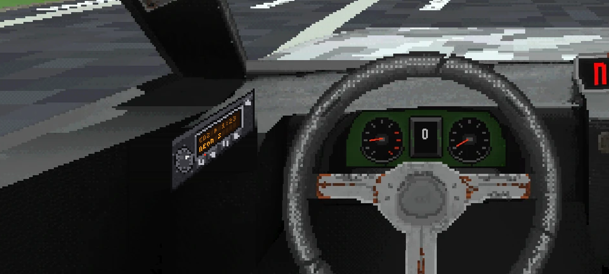

# Car Stereo

**Version 0.2.2** for Half Grip 0.418, a [HalfGripTools](https://github.com/4l3x4nd3r0/HalfGripTools) mod (1.0.2 or newer).

A CD stereo built into your car's cockpit. It sits left of the steering wheel, and a CD wallet hangs on the sun visor with one disc for
each song of the game's soundtrack plus one disc, **MY**, that plays your own songs from a folder on your computer. You work it with
the cockpit hand, like the shifter and the levers. No keys.

## Using it

- **Put a disc in:** grab it by the crescent showing in the wallet on the visor, carry it to the stereo and let go: it slides into
  the slot. Its sleeve stays empty while it's out.
- **Take it out:** right click anywhere on the stereo (or click the eject key beside the slot). The disc comes half out of the slot;
  grab it and drop it on the visor to put it away, or let it fall: once it's out of sight it's back in its sleeve. A disc dropped
  anywhere but the stereo or the visor falls the same way. Dropping a new disc in swaps it for the one playing.
- **Volume knob** (left of the display): grab it and turn it, clockwise for louder. The game's Music volume applies on top.
- **Keys under the display:** power, previous, play / pause, next. On a soundtrack disc, previous and next change disc. On MY they
  change song.

The stereo replaces the race music. Until you pick a disc it plays the song the game would have played, so the race sounds as it
always did. Once you pick a disc it stays in from race to race (until you quit the game).

The soundtrack discs are Forest, Neon, Neon 2 (Tokyo's second song), Factory, Stadion and Winter, found in the game itself. Nothing
is copied into the mod.

## Your own songs

Put `.ogg`, `.mp3`, `.wav` or `.aiff` files in **`Music\Half Grip`** in your user folder (made the first time you play the MY disc),
or point `Music.Folder` in the config at any folder. They play in file name order, so number them (`01 ...`, `02 ...`) to set it, or
turn on `Music.Shuffle`. The mod only reads that folder: it never writes to it or anywhere else.

## Install

1. Install [HalfGripTools](https://github.com/4l3x4nd3r0/HalfGripTools).
2. Copy the **`Stereo`** folder from this repo into `<game>\BepInEx\HalfGripMods\`, so that `mod.json` is at
   `HalfGripMods\Stereo\mod.json`. Copy only that folder, not the whole repo download.

## Settings

`BepInEx\config\halfgrip.stereo.cfg`. Changes to the stereo's place take effect as soon as the file is saved, even mid-race.

| Setting | Default | |
|---|---|---|
| `Stereo.Enabled` | true | Off: no stereo, the game's own music |
| `Stereo.OffsetX` / `OffsetY` | 0 | Move the stereo (cockpit units, a cockpit pixel is about 0.05) |
| `Stereo.Perspective` | 1 | How far the stereo is drawn in the dash's perspective (1 as the cockpit camera sees it, 0 face on) |
| `Visor.Shown` | true | The CD wallet on the visor |
| `Visor.ScreenX` / `ScreenY` | 0.3 / 0.87 | Where the wallet sits on the screen |
| `Music.Folder` | (empty) | The MY disc's folder; empty is `Music\Half Grip` |
| `Music.Shuffle` | false | Shuffle the MY disc |
| `Music.Volume` | 7 | The volume knob (0 to 10), saved as you turn it |
| `Music.Loudness` | 1 | The stereo at full volume against the game's own music |
| `Display.Lit` | true | Light the stereo like the cockpit; turn off if it doesn't show |
| `Debug.VerboseLog` | false | Write what the stereo finds and does to `BepInEx\LogOutput.log` |
